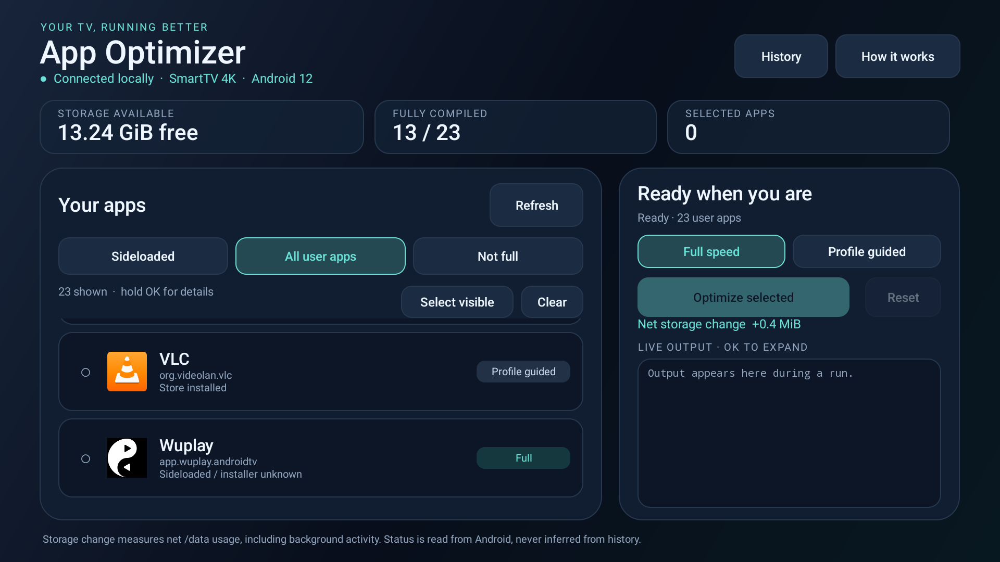
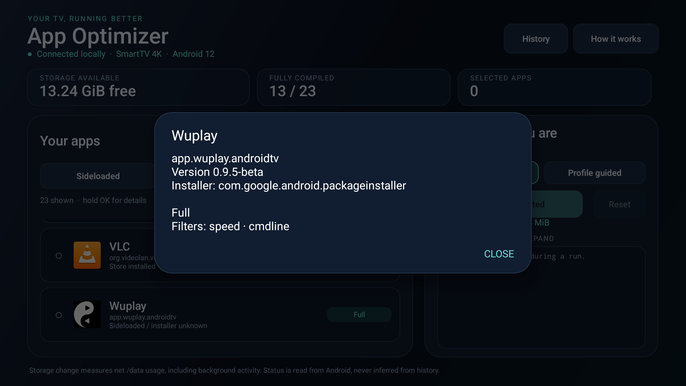

# App Optimizer

A lightweight Android TV app for compiling your installed apps with a remote control. Choose your apps, start a run, and see Android's actual compilation status and the net storage change. You can also remove precompiled code when you want to recover space.

App Optimizer is a separate utility. It preserves your launcher, streaming apps, app data, sign-ins and network settings. No root, Google account, subscription or computer is needed for everyday use after installation and setup.

## Install

| Edition | Download APK | Downloader code |
| --- | --- | --- |
| TV — Android 8–13 | [TV APK](https://github.com/uta-dasp/app-optimizer/releases/download/v1.0.0/App-Optimizer-v1.0.0-TV.apk) | **3178986** · [short link](https://aftv.news/3178986) |
| Full — Android 7+ compatibility | [Full APK](https://github.com/uta-dasp/app-optimizer/releases/download/v1.0.0/App-Optimizer-v1.0.0-Full.apk) | **2442807** · [short link](https://aftv.news/2442807) |

With the Downloader app on the TV: enter the numeric code in its URL/search field, choose Go, wait for the APK download, then choose Install. If requested, allow Downloader to install unknown apps. Open App Optimizer and follow the connection steps below. Each code is pinned to this exact1.0.0 APK, not an automatic-update feed. Check GitHub Releases for later versions and compare the suppliedSHA256 file when verifying downloads.

1. Open the public [latest release](https://github.com/uta-dasp/app-optimizer/releases/latest). No GitHub account is required.
2. Download the signed App Optimizer APK. The release also includes its checksum.
3. Transfer the APK to your TV and install it using your usual APK installer. If Android asks, allow that installer to install unknown apps.
4. Open **App Optimizer** from your TV's app drawer.

For later updates, install the new release over the existing app to retain its history and connection identity. See [build, signing and rollback instructions](docs/BUILD-AND-RELEASE.md) if you maintain or distribute your own build.

## Connect once

1. On the TV, open **Settings → Developer options**. If Developer options is hidden, open the TV's About screen and repeatedly select its Android TV OS build entry until developer mode is enabled. The wording and location vary by TV.
2. Enable the TV's **USB debugging** setting. If your firmware has a separate **Network debugging** or **ADB debugging** switch for its legacy ADB connection, enable that too.
3. Open App Optimizer and choose **Connect to this TV**.
4. In Android's **Allow USB debugging?** dialog, select **Always allow from this computer**, then **Allow**. Here, the authorized client is App Optimizer itself.
5. Wait for the app list and compilation statuses to appear.

The app connects only to the TV itself at `127.0.0.1:5555`. Keep the required debugging setting enabled for future runs. You do not need to enter commands or connect a computer each time. If Android expires or revokes the authorization, reconnect and approve it again.

**Wireless debugging's pairing-code screen is a different connection method.** This version does not support that TLS pairing protocol. It requires the TV's legacy local ADB connection.

### Which APK should I use?

| APK | Intended Android TV versions | Notes |
| --- | --- | --- |
| **TV** | Android 8–13 | Conservative edition using commands tested on Hisense Android 12. |
| **Full** | Android 7 and later | Adds Android 7 interpretation-based reversal and Android 14+ ART commands with capability checks. |

Both APKs contain all app code and support all CPU architectures without separate ARM/x86 downloads. Both are **TV-only**. They share the same package, signing key and version code: install only one edition at a time; installing either over the other preserves App Optimizer data. Download links and distinct Downloader codes are provided below.

**Compatibility is not guaranteed for every TV.** Both require legacy local ADB on port 5555; neither implements TLS wireless pairing, root or Shizuku. Hardware testing covers Android 12 only. Android 7 and 14+ branches have source-based compatibility checks and parser/command tests, but have not been tested on those physical Android versions. Android 6 and earlier lack the required compilation interface. If modern firmware does not advertise primary-dex-only compilation, Full refuses to start rather than also modify dependencies. On Android 14+, status and operations cover primary APK/split code; secondary dynamic dex files are outside that scope. Android 7's older status format may show Unknown.

## Choose apps with your remote

Use the **D-pad** to move and **OK / Select** to activate a control.

- **Sideloaded** shows apps whose installer metadata does not identify Google Play. This is an estimate: an unknown installer does not prove how an app was installed.
- **All user apps** includes store-installed and sideloaded user apps. System apps are excluded; App Optimizer protects itself from operations.
- **Not full** shows apps that do not currently report full compilation. This includes profile-guided apps, which are already optimized using a different strategy.
- Press **OK** on an app row to select or deselect it. Select several apps for one sequential batch.
- **Select visible** selects the eligible apps in the current view. **Clear** clears your selection. Selections remain selected when you change filters, so check **Selected apps** before starting.
- **Hold OK** on an app row to see its package, version, installer and reported compilation details.
- **Refresh** rereads the app list, storage and Android's compilation records.

## Optimize

First select one or more apps, then choose a compilation mode:

| Mode | What it requests | When to choose it |
| --- | --- | --- |
| **Full speed** | Compile app code ahead of time using Android's `speed` mode. | You want full compilation and have storage to spare. Speed gains vary by app. |
| **Profile guided** | Compile code selected by Android's available learned profiles. | You prefer a smaller compilation footprint. A missing or limited profile may leave little code compiled. |

Choose **Optimize selected**, review the confirmation, then choose **Start**. Leave App Optimizer open while it works. Apps run **one at a time**; some take several minutes without producing intermediate output.

Watch the current app, live output and net storage change. Select the output area to open **Command output** at a larger size. When the batch finishes, review the resulting statuses or open **History** for each app's result.

**Stop after current app** finishes the request already in progress and prevents the next app from starting. It does not undo the current request. Pressing Back during a run offers **Keep running** or **Stop queue**.

There are no scheduled runs or automatic retries. If the app stops, the TV restarts or the connection breaks, an uncertain result is recorded instead of silently repeating a command. Refresh status before deciding whether to run it again.

Compilation can improve some app startup or execution paths. It does not promise faster streaming, better network performance or faster video decoding. The app stops starting new compilation requests when less than 512 MiB is free; this is a preflight check, not a hard limit on the storage an in-flight request may use.

## Read the status badges

Statuses come from Android's compilation records, not from your past button presses. A command returning `Success` does not, by itself, earn a Full badge.

| Status | Meaning |
| --- | --- |
| **Full** | All reported code entries use full compilation. |
| **Profile guided** | Android reports profile-based compilation. This is an optimized state. |
| **Verified only** | Android checked the code without ahead-of-time method compilation. |
| **Interpreted** | Android 7 reports interpretation instead of ahead-of-time bytecode compilation. Native/JNI stubs may remain. |
| **Mixed** | Reported code paths or architectures use different compilation modes. |
| **Not compiled** | Android reports execution from the APK or an equivalent noncompiled state. |
| **Unknown** | Android did not expose a recognized, readable record. This does not prove the app is unoptimized. |

Debug builds may remain **Verified only** after a successful request because Android restricts their compilation. App updates and Android's normal background optimization can also change badges later. Use **Refresh** when you want a current reading.

## Reverse a compilation

1. Select the apps you want to change.
2. Choose **Reset**.
3. Read the explanation and choose **Remove code**.

On Android8 and newer, this action switches the selected apps to verification-only compilation using `pm compile -m verify -f`. Full uses `interpret-only` on Android7 instead; some native/JNI stubs may remain. It removes precompiled methods while preserving **app data, sign-ins and learned profiles**. Android can compile the apps again during later use or background maintenance.

Reset is not an exact restore point. It does not recreate an app's earlier learned profile or guarantee that every byte reported during compilation will be recovered. Verification metadata still occupies some space.

The full post-install `pm compile --reset` operation was rejected by the tested Hisense firmware because clearing all profile data requires system privileges. App Optimizer deliberately uses the verification-only operation instead and does not try to bypass that restriction.

## Understand storage changes and history

- **Storage available** is free space on the TV's `/data` filesystem.
- **Net storage change** compares free space before and after a run. A positive number means more storage is used; a negative number means space was freed.
- The measurement includes concurrent TV activity such as cache writes, downloads, logs and cleanup. It is **not the exact size of compiled files**.
- Unavailable measurements are shown as unavailable, rather than a fabricated zero.
- **History** saves recent per-app requests locally, with the operation, result, elapsed time, before/after status and measured storage change.
- **Clear history** removes only those records. It does not alter compilation or other apps.

## Troubleshooting

| Problem | What to do |
| --- | --- |
| Cannot connect / port 5555 is closed | Check that the TV's compatible USB/network ADB debugging setting is enabled. Wireless pairing alone is insufficient. Open **How it works → Open Developer options** for help reaching the setting. |
| Authorization is required | Choose **Connect to this TV** and approve Android's dialog with **Always allow**. Approval may be needed again after revocation, inactivity, cleared app storage or a firmware change. |
| A request takes a long time with no output | Android often prints only the final result. Leave the app open. Use **Stop after current app** if you want to prevent subsequent requests. |
| A debug app stays Verified only | This can be Android's intended behavior. Check the details by holding OK; do not assume another run will change the result. |
| Unknown or Mixed status | Refresh, then inspect the app's details. Firmware can expose limited records or multiple filters. The app does not claim full optimization without evidence. |
| Interrupted request or uncertain outcome | Refresh Android's current status before taking another action. Requests are never automatically replayed. |
| Not enough storage | Remove unneeded downloads or other content, or use **Reset** to remove precompiled code from selected apps. The app does not delete app data for you. |

To stop all future App Optimizer commands, turn off the relevant debugging setting. To revoke its authorization, use **Developer options → Revoke USB debugging authorizations**. That Android action also affects other trusted debugging clients. Clearing App Optimizer's storage or uninstalling it removes its local identity and history, but does not independently revoke an already trusted public key on the TV.

## Privacy and project

The app has no ads, analytics, cloud account, accessibility service, overlay or background monitoring. Its connection key is encrypted using Android Keystore and stored in backup-excluded private storage. It uses native Android UI and has no third-party runtime dependencies or bundled ADB executable.

`main` tracks released source; `developer` is for tests. Tagged [releases](https://github.com/uta-dasp/app-optimizer/releases) preserve the APK and source history. Compilation reversal and installing an older App Optimizer version are separate actions; see [build and rollback](docs/BUILD-AND-RELEASE.md) and [Android behavior details](docs/ANDROID-BEHAVIOR.md).

Licensed under [MIT](LICENSE). The local ADB transport is adapted from Free My TV; its MIT notice is retained in [third-party notices](THIRD-PARTY-LICENSE.txt).
